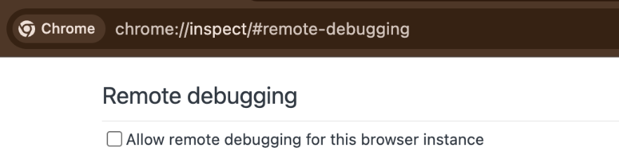

# Wine View 🍷

> Fork of [browser-use/browser-harness](https://github.com/browser-use/browser-harness) (MIT, © Browser Use), renamed to wine-view. Telemetry and the PyPI update check are removed: it sends nothing anywhere except the sites you drive and, only if you opt in with an API key, Browser Use Cloud.
>
> On macOS you do not have to enable remote debugging in Chrome. Each agent session starts its own Chrome from the profile you pick. See [Remote debugging](#remote-debugging).

Connect an LLM directly to a real browser through one editable CDP connection. The agent writes missing helpers as it works, so the harness improves with every task.

Paste the setup prompt into your coding agent.

```
  ● agent: wants to upload a file
  │
  ● agent-workspace/agent_helpers.py → helper missing
  │
  ● agent writes it                         agent_helpers.py
  │                                                       + custom helper
  ✓ file uploaded
```

**You will never use the browser again.**


## What's different in this fork

wine-view is [browser-use/browser-harness](https://github.com/browser-use/browser-harness) 0.1.13 (MIT, © Browser Use), renamed and made private-by-default:

| Change | Upstream | wine-view |
|---|---|---|
| CLI | `browser-harness`, `browser-harness-mcp` | `wine-view`, `wine-view-mcp` |
| Python package | `browser_harness` | `wine_view` |
| Config dir | `~/.config/browser-harness` | `~/.config/wine-view` |
| Env vars | `BH_*`, `BU_*`, `BROWSER_HARNESS_*`, `BROWSER_USE_*` | `WV_*`, `WINE_VIEW_*` |
| Runtime files | `bu-<name>.sock/.pid/.log` | `wv-<name>.sock/.pid/.log` |
| Tab marker | 🐴 | 🍷 |
| Telemetry | PostHog events on every command (opt-out) | **removed** (`telemetry.py` is a no-op stub) |
| Update check | daily PyPI version check | **removed**; update with `git pull` |
| First attach on local Chrome | attaches to your first open tab (slow if it is a busy background tab) | opens/reuses its own blank background tab — never touches your tabs (fresh start ~13s → ~1.9s) |
| Chrome "Allow remote debugging?" prompt (shown only when attaching to your own Chrome) | click Allow or run `mac-approve` | optional auto-allow: set `WV_AUTO_APPROVE=1` (macOS, needs Accessibility permission for your terminal) |
| Default browser on macOS | your running Chrome, after you enable remote debugging at `chrome://inspect` | a separate Chrome for each agent session, started by wine-view on a throwaway profile and driven over a private pipe. Nothing has to be enabled in Chrome, and there is no debugging port or approval prompt |
| Sign-ins in that Chrome | whatever your running Chrome has | copied from the Chrome profile you pick, or none with `fresh`. The agent has to ask you which one |
| Headless | no switch for a local browser | `WV_HEADLESS=1` starts the session's Chrome with no window |

Nothing is sent anywhere except the sites you drive, plus Browser Use Cloud only if you set `WINE_VIEW_API_KEY`.

### Remote debugging

Whether you have to enable remote debugging depends on which Chrome wine-view drives.

| wine-view drives | Enable remote debugging in Chrome? |
|---|---|
| Its own Chrome for each agent session, the default on macOS | No |
| Your own running Chrome: `WV_CDP_WS=` with an empty value on macOS, and the default on Linux and Windows | Yes, at `chrome://inspect/#remote-debugging` |
| Its own Chrome on Linux with `WV_CDP_WS=pipe` (untested) | No |

Every mode uses the Chrome DevTools Protocol. In the default macOS mode wine-view starts Chrome with `--remote-debugging-pipe` and holds the other end of that pipe, so Chrome opens no debugging port and your own Chrome is not involved. If you never attach to your own Chrome, you can leave remote debugging switched off in it.

### One Chrome per agent session

On macOS each agent session gets its own Chrome process on a throwaway profile named Ø. wine-view starts it in the background and talks to it over a private pipe (`--remote-debugging-pipe`). Nothing has to be enabled in Chrome, there is no debugging port or approval prompt, and a session shares no tabs or cookies with other sessions or with your own browser. A session is whatever `CLAUDE_CODE_SESSION_ID` says. Without that variable all commands share one Chrome unless they set `WV_NAME`, and parallel sub-agents each set their own `WV_NAME` to get a Chrome each.

You choose which of your Chrome profiles a session starts from. The first browser command stops with `profile-choice-needed` and lists them, and the agent is told to ask you which one.

```bash
wine-view profile                  # list your profiles and this session's choice
wine-view profile use "Profile 2"  # start from that profile's sign-ins
wine-view profile use fresh        # start signed out
```

wine-view copies the `Cookies`, `Network`, `Local Storage` and `IndexedDB` entries from the profile folder and writes nothing back to it. Saved passwords, payment data, history and extensions are not copied. Cookies that last only until the browser closes do not carry over, so a site you signed in to without "remember me" shows as signed out. A sub-agent or an unattended run cannot ask you, so it takes the answer from `WV_PROFILE=<folder>` or `WV_PROFILE=fresh`.

The Chrome closes and its profile is deleted when the session's Claude Code process exits, or on `wine-view --reload`. Its window opens behind your other windows. With `WV_HEADLESS=1` it has no window at all. That variable is read when the session's Chrome starts, so set it on every command of a task, and run `wine-view --reload` first to switch a session that is already running.

Pages can tell this Chrome is automated: `navigator.webdriver` is `true`, and in headless mode the user agent says `HeadlessChrome`. A site that blocks automated browsers may refuse it. For such a site, or for a task that needs your saved passwords or extensions, attach to your own running Chrome by giving `WV_CDP_WS` an empty value on every command. That mode needs remote debugging enabled at `chrome://inspect/#remote-debugging`.

```bash
WV_CDP_WS= wine-view <<'PY'
print(page_info())
PY
```

This is the default on macOS only, tested on macOS 12 with Chrome 150. On Linux it is opt-in with `WV_CDP_WS=pipe` and untested. It does not work on Windows. On both, wine-view attaches to your running Chrome as before.

### Install

```bash
git clone https://github.com/Bibin-VR/wine-view.git ~/Developer/wine-view
uv tool install --python 3.12 -e ~/Developer/wine-view
ln -s ~/Developer/wine-view/skills/wine-view ~/.claude/skills/wine-view   # Claude Code skill
```

On macOS nothing has to be enabled in Chrome; the first browser command asks which profile to start from, as described above. On Linux and Windows, and on macOS with `WV_CDP_WS=`, wine-view attaches to your running Chrome, so enable remote debugging at `chrome://inspect/#remote-debugging` first. To stop auto-allowing, unset `WV_AUTO_APPROVE`; to cut access entirely, turn remote debugging off.

### Syncing with upstream

```bash
git fetch upstream && git merge upstream/main   # then re-apply the rename to new text, run `pytest tests/unit`, and check no telemetry/update calls came back
```

## See it work

**Task:** "Open my X profile, find my latest 20 video posts, and download them."

[](https://browser-use.com/showcase/videos/download-latest-20-x-videos.mp4)

## Setup prompt

Paste into Claude Code or Codex:

```text
Install or upgrade wine-view to the latest stable version with uv using Python 3.12, register the skill from `wine-view skill`, and connect it to my browser. Ask whether I want local browser recordings enabled; default to no and preserve my existing preference on upgrades. Follow https://github.com/Bibin-VR/wine-view/blob/wine-view/install.md if setup or connection fails.
```

On macOS there is nothing to enable in Chrome. The first browser command asks
which Chrome profile to start from.

### If you attach to your own running Chrome

This is the default on Linux and Windows, and what `WV_CDP_WS=` (an empty
value) selects on macOS. The agent will open `chrome://inspect/#remote-debugging`.
On first setup, tick the checkbox so the agent can connect to your browser:



## How it works

- [`install.md`](install.md) connects the agent to your browser.
- [`SKILL.md`](SKILL.md) teaches it the browser workflow.
- [`src/wine_view/`](src/wine_view/) stays protected while the agent writes reusable helpers in its local workspace.

## Scale with Browser Use Cloud

Use your local browser for logged-in, personal work. When you want many browsers in parallel—with live previews, proxies, stealth, CAPTCHA solving, and more—scale with [Browser Use Cloud](https://cloud.browser-use.com/new-api-key).

## MCP server

`wine-view-mcp` exposes the browser control helpers as MCP tools over
stdio, so any MCP client (Claude Code, Devin, Cursor, etc.) can drive the
browser without writing a second CDP layer. See [docs/MCP.md](docs/MCP.md) for
setup and client configuration.

## Contributing

Bug fixes, documentation improvements, and agent-generated domain skills are welcome. See [CONTRIBUTING.md](CONTRIBUTING.md).

---

[The Bitter Lesson of Agent Harnesses](https://browser-use.com/posts/bitter-lesson-agent-harnesses) · [Web Agents That Actually Learn](https://browser-use.com/posts/web-agents-that-actually-learn)
